# The Complete CI/CD Pipeline Guide

### React → GitHub Actions → Container Registry → Git → Argo CD → Kubernetes

These notes explain **how this project's pipeline works, why each piece exists, and how the pieces connect**. They go from theory to configuration to production practice. Read them in order: each part builds on the one before.

> The diagrams use [Mermaid](https://mermaid.js.org/). GitHub, VS Code (with a Mermaid extension) and IntelliJ all render them.

---

## Table of contents

1. [The big picture](#1-the-big-picture)
2. [Core theory: CI, CD and GitOps](#2-core-theory-ci-cd-and-gitops)
3. [Containers: packaging the app](#3-containers-packaging-the-app)
4. [GitHub Actions: the CI engine](#4-github-actions-the-ci-engine)
5. [Kubernetes: running the app](#5-kubernetes-running-the-app)
6. [Namespaces in depth](#6-namespaces-in-depth)
7. [Argo CD: the CD engine](#7-argo-cd-the-cd-engine)
8. [How Kubernetes and Argo CD connect](#8-how-kubernetes-and-argo-cd-connect)
9. [End-to-end: following one change](#9-end-to-end-following-one-change)
10. [File-by-file connection map](#10-file-by-file-connection-map)
11. [Building the pipeline from scratch (recipe)](#11-building-the-pipeline-from-scratch-recipe)
12. [Operating it: rollback, self-heal, debugging](#12-operating-it-rollback-self-heal-debugging)
13. [Production-level best practices](#13-production-level-best-practices)
14. [Glossary](#14-glossary)

---

## 1. The big picture

The whole system fits in one diagram. Every box is explained later.

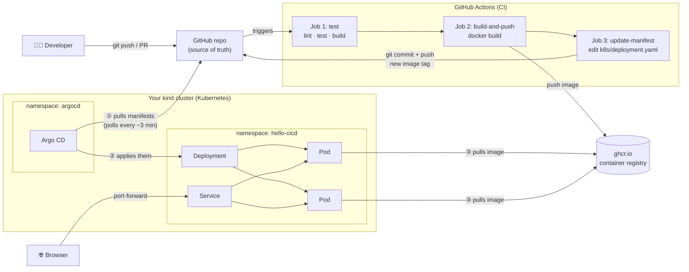

**The key point:** the arrows into the cluster all **start inside the cluster**. GitHub never connects to Kubernetes. Argo CD reaches out to Git, and the nodes reach out to the registry. This is the **pull model** of **GitOps**, and it's why a cluster on your laptop works with a pipeline in the cloud.

There are three separate "worlds", each with its own job:

| World | Tool | Its one job | Output |
|---|---|---|---|
| **Build** | GitHub Actions | Turn source code into a tested, versioned image | An image in ghcr.io |
| **Desired state** | Git (`k8s/` folder) | Record *what should be running* | A commit that changes the image tag |
| **Run** | Argo CD + Kubernetes | Make the cluster match Git, and keep it that way | Running pods |

---

## 2. Core theory: CI, CD and GitOps

### 2.1 Continuous Integration (CI)

**Problem it solves:** when many people change code and merge it rarely, merging becomes painful and bugs are found late.

**Idea:** every change is **integrated** (merged) often, and **every change is automatically verified** by building and testing it.

In this project, CI is the `test` job: `npm ci → lint → test → build`. It runs on every pull request, so a broken change is caught **before** it reaches `main`.

### 2.2 Continuous Delivery vs Continuous Deployment (CD)

Both are called "CD", but they differ:

| | Continuous **Delivery** | Continuous **Deployment** |
|---|---|---|
| Every passing change is… | *ready* to deploy | *actually* deployed |
| Production release | a human clicks "approve" | fully automatic |
| This project | | ✅ this one: merging to `main` deploys |

Many production teams use Delivery for production (a human gate) and Deployment for dev/staging.

### 2.3 Push-based CD vs pull-based CD (GitOps)

There are two ways to get a new version onto a cluster:

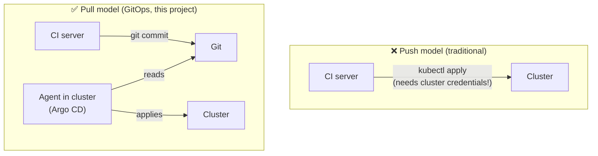

| | Push | Pull (GitOps) |
|---|---|---|
| Who needs cluster credentials? | The CI system (a big security risk) | Nobody outside the cluster |
| Cluster must be reachable from internet? | Yes | No, it only makes outbound connections |
| What if someone runs `kubectl edit`? | The change stays, and the cluster *drifts* from Git | Argo CD reverts it (self-heal) |
| How do you roll back? | Re-run an old pipeline | `git revert` |
| Deploy history | Scattered in CI logs | `git log k8s/` |

### 2.4 The four GitOps principles

The [OpenGitOps](https://opengitops.dev/) project defines GitOps by four principles. Here's how this project meets each one:

1. **Declarative.** You describe the *desired end state* ("2 replicas of image X"), not the steps to get there. → `k8s/deployment.yaml`
2. **Versioned and immutable.** The desired state is stored in Git, with full history. → every deploy is a commit
3. **Pulled automatically.** Software agents pull the desired state from Git. → Argo CD polls the repo
4. **Continuously reconciled.** Agents keep comparing the actual state to the desired state and fix any difference. → `selfHeal: true`

### 2.5 The reconciliation loop: the most important idea

Both **Kubernetes** and **Argo CD** are built on the same pattern, the **control loop**:

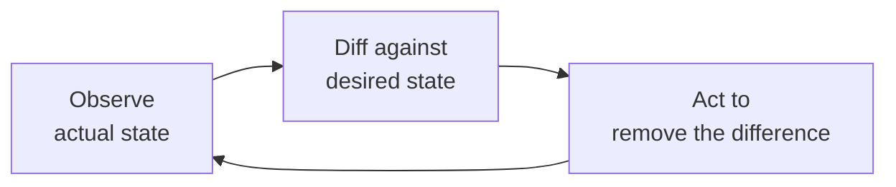

A thermostat works the same way: you set 22 °C (desired), it measures 19 °C (actual), and it turns on the heat (act). Once you understand this loop, Kubernetes and Argo CD stop feeling like magic:

- **Argo CD's loop:** desired = Git, actual = the Kubernetes API → act = apply manifests
- **Kubernetes' Deployment loop:** desired = `replicas: 2`, actual = number of running pods → act = create or delete pods

---

## 3. Containers: packaging the app

### 3.1 Why containers?

"It works on my machine" happens because the code depends on things around it: OS, libraries, runtime versions. A **container** packages the app *together with* everything it needs. It then runs the same way on your laptop, the CI runner and every Kubernetes node.

| Term | Meaning | Analogy |
|---|---|---|
| **Image** | A read-only template: filesystem layers plus metadata ("run nginx on port 80") | A class / a recipe |
| **Container** | A running instance of an image, isolated from other processes | An object / the cooked meal |
| **Layer** | Each Dockerfile instruction creates a cached layer; unchanged layers are reused | Save points |
| **Registry** | A server that stores and serves images (ghcr.io, Docker Hub, ECR) | A library / app store |
| **Tag** | A human-readable name for one image version: `:sha-abc1234` | A git tag |
| **Digest** | The image's content hash, `@sha256:…`; it's truly immutable | A git commit SHA |

### 3.2 This project's Dockerfile: a multi-stage build

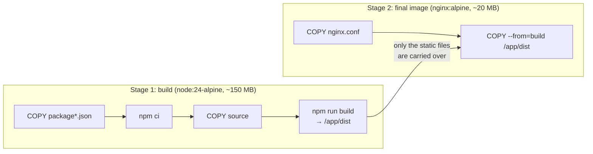

**Why two stages?** A React app becomes plain HTML, JS and CSS after `npm run build`. To serve those files you need no Node, no `node_modules` and no source code. The final image contains **only nginx and `dist/`**, so it's smaller, faster to pull and has less attack surface.

**Why copy `package*.json` before the rest of the source?** Layer caching. Dependencies change rarely and source changes often. Putting `npm ci` in its own layer means a code-only change reuses the cached dependency layer.

**What `--platform=$BUILDPLATFORM` does:** the build stage runs natively on the CI machine (amd64), even when the final image is arm64. Compiling JavaScript produces the same output on any CPU, so there's no need to emulate it, which is slow.

**`.dockerignore`** keeps `node_modules`, `.git`, `k8s/` and other files out of the *build context* (the files sent to Docker). That makes builds faster and stops secrets from leaking into the image by accident.

### 3.3 nginx and single-page apps

```nginx
location / {
    try_files $uri $uri/ /index.html;
}
```

React handles routing in the browser. If a user reloads `/about`, no `about` file exists on disk. This rule says: "serve the file if it exists, otherwise serve `index.html` and let React handle the route."

### 3.4 Image tagging strategy

The pipeline tags images `sha-<first 7 chars of commit>`, for example `sha-2327152`.

| Tag style | Good? | Why |
|---|---|---|
| `:latest` | ❌ for deployments | It changes meaning over time. Kubernetes can't tell "latest" changed, so nothing rolls out, and you can't roll back to "the previous latest". |
| `:sha-2327152` | ✅ | One image per commit. Traceable: image → commit → code. Rolling back means going back to a previous tag. |
| `:1.4.2` (semver) | ✅ for releases | Readable for humans; often used together with a SHA tag |
| `@sha256:…` (digest) | ✅✅ most secure | Content-addressed; it can't be overwritten, even by mistake |

---

## 4. GitHub Actions: the CI engine

### 4.1 The vocabulary

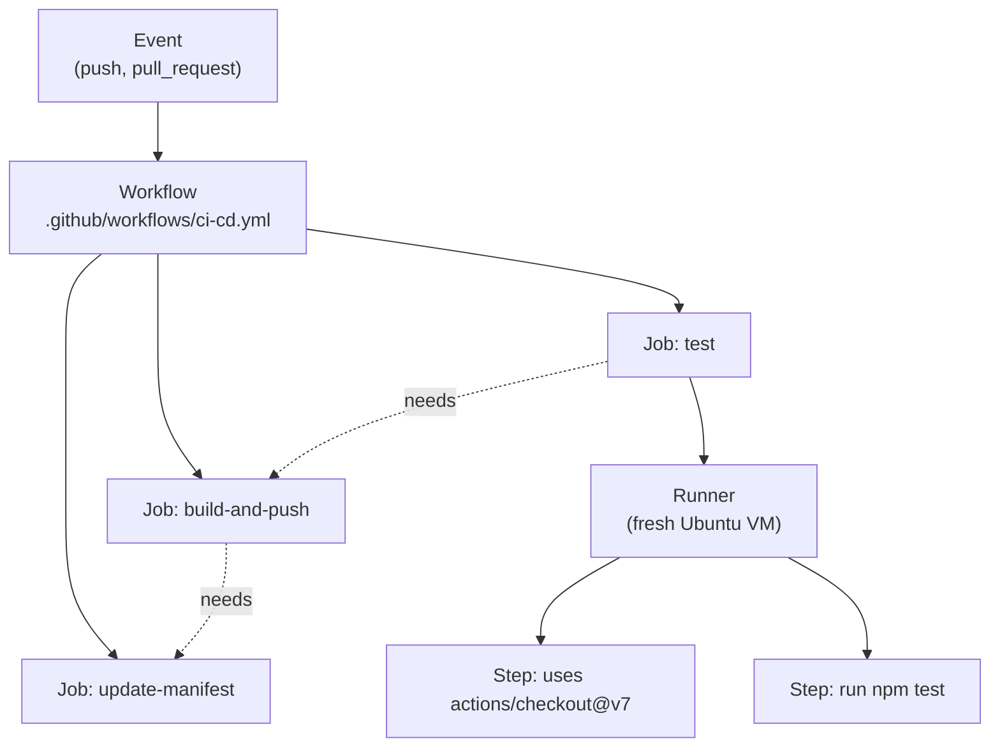

| Concept | Meaning |
|---|---|
| **Workflow** | A YAML file in `.github/workflows/`. GitHub picks it up automatically. |
| **Event / trigger** | What starts the workflow: `on: push`, `on: pull_request`, a schedule, a manual run… |
| **Job** | A group of steps that run on **one runner**. Jobs run **in parallel** unless linked with `needs:`. |
| **Runner** | The machine that runs a job. `ubuntu-latest` is a **brand-new VM for each job**, deleted afterwards. Jobs **don't share files**, which is why each job runs `checkout` again. |
| **Step** | Either `run:` (a shell command) or `uses:` (an action). |
| **Action** | A reusable plugin, published as a Git repo. `actions/checkout@v7` = repo `github.com/actions/checkout` at tag `v7`. |
| **Expression** | `${{ … }}` is filled in by GitHub *before* the step runs, e.g. `${{ github.sha }}`. |
| **Context** | Data you can read in expressions: `github.*` (event, ref, actor), `secrets.*`, `needs.*`, `steps.*`, `env.*`. |
| **Outputs** | How data passes between steps and jobs (`$GITHUB_OUTPUT` → `steps.vars.outputs.image` → `needs.build-and-push.outputs.image`). |

### 4.2 Which jobs run on which event

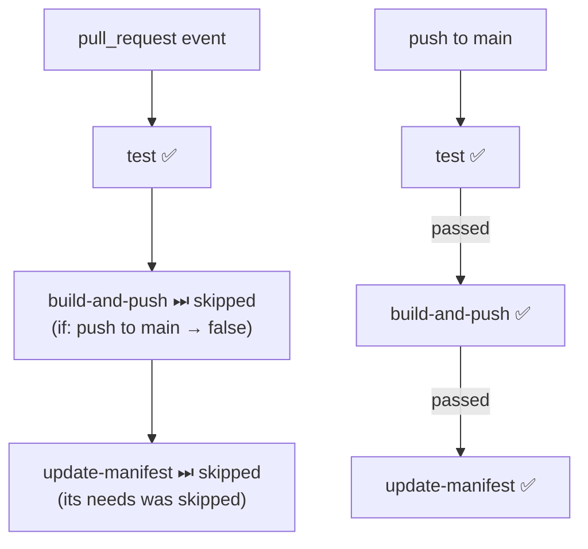

So a **PR = verification only**, and a **merge = verify + release + deploy**.

### 4.3 How data flows between jobs

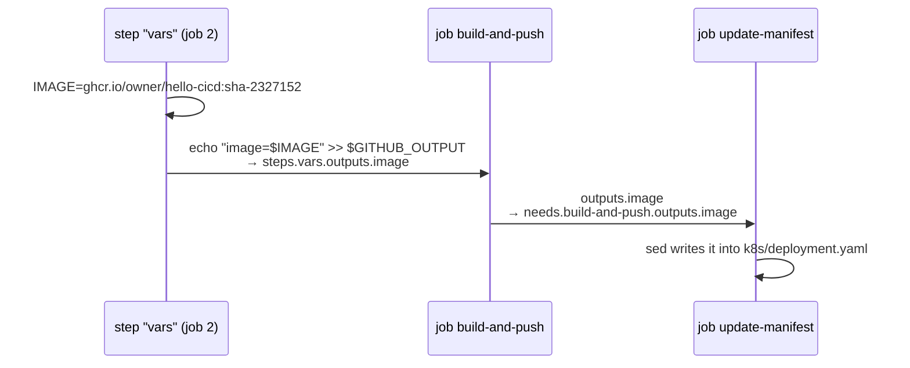

### 4.4 Security: `GITHUB_TOKEN` and `permissions`

GitHub creates a short-lived **`GITHUB_TOKEN`** for every run. It expires when the job ends. The `permissions:` block sets the **least privilege** each job needs:

| Job | Permissions | Why |
|---|---|---|
| `build-and-push` | `contents: read`, `packages: write` | Read the code; push the image to ghcr.io |
| `update-manifest` | `contents: write` | Commit the new tag back to the repo |

This is also why the README says to enable **"Read and write permissions"** in the repo settings. Otherwise `contents: write` is capped at read, and you get a 403.

### 4.5 Preventing an infinite loop

The pipeline commits to `main`, and a commit to `main` starts the pipeline. Three separate protections stop this from looping:

1. `paths-ignore: ['k8s/**', …]`: the bot only changes `k8s/`, so its push matches nothing that triggers a run.
2. `[skip ci]` in the commit message: GitHub skips workflows for commits with this text.
3. A built-in GitHub rule: **events created with `GITHUB_TOKEN` never start new workflow runs.**

Any one of these would be enough. Having all three is defence in depth.

### 4.6 Other details in the workflow

- **`concurrency: deploy`:** two merges close together could make two bots edit the manifest at the same time. Concurrency queues them.
- **`git pull --rebase` before `git push`:** if someone pushed while the image was building, the bot's commit goes on top of their commit instead of being rejected.
- **`cache: npm` and `cache-from/to: type=gha`:** reuse downloads and Docker layers between runs, so builds take seconds instead of minutes.
- **QEMU + Buildx and `platforms: linux/amd64,linux/arm64`:** one image tag works on Intel and on Apple Silicon (your kind cluster).

---

## 5. Kubernetes: running the app

### 5.1 What Kubernetes is

Kubernetes (K8s) is a **container orchestrator**. You tell it "I want 2 copies of this container, reachable on port 80", and it:

- decides **which machine** runs each copy (scheduling),
- **restarts** copies that crash (self-healing),
- **replaces** copies one at a time when you change the version (rolling updates),
- gives them a **stable network address** (services and DNS).

Everything is **declarative**: you submit YAML that describes the desired state, and controllers make it happen through the reconciliation loop from §2.5.

### 5.2 Cluster architecture

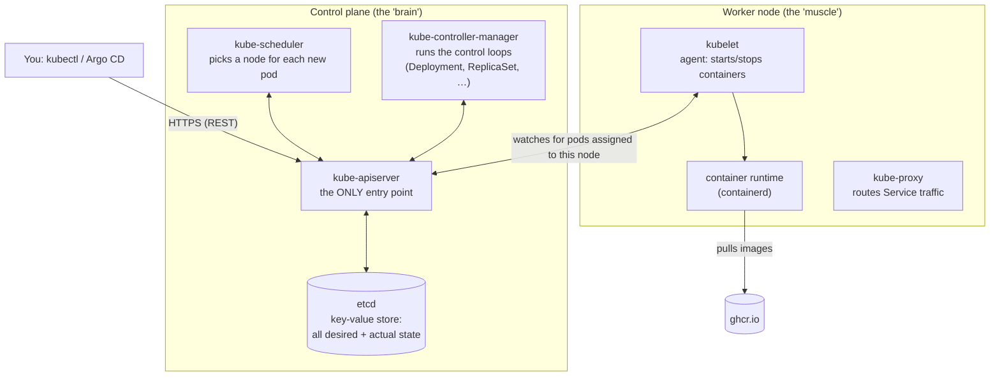

| Component | Role |
|---|---|
| **kube-apiserver** | The front door. Every tool talks to it, and the components never talk to each other directly. |
| **etcd** | The database. If it isn't in etcd, it doesn't exist. |
| **scheduler** | Assigns new pods to nodes, based on free CPU and memory and on constraints. |
| **controller-manager** | Runs dozens of control loops ("there should be 2 pods, there's 1, so create 1"). |
| **kubelet** | Runs on every node and makes the pods assigned to that node actually run. |
| **container runtime** | Pulls images and runs containers (containerd). |
| **kube-proxy** | Programs network rules so Service IPs reach the right pods. |

**In your setup (kind):** "Kubernetes IN Docker" runs a whole node, control plane included, **as a single Docker container** on your Mac. Run `docker ps` to see `cicd-control-plane`. It's a real cluster, just small.

### 5.3 Objects, from small to large

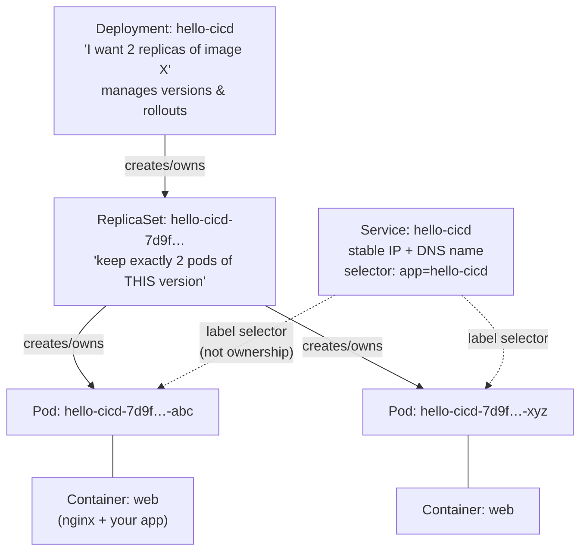

#### Pod
- The **smallest deployable unit**: one or more containers that share a network IP and storage.
- **Pods are mortal.** They're replaced, never repaired. Each new pod gets a new name and a new IP.
- You almost never create pods directly; a Deployment creates them.

#### ReplicaSet
- Makes sure **N identical pods** are running.
- Each Deployment *version* has its own ReplicaSet. That's how rollbacks work: the old ReplicaSet still exists, scaled to 0.

#### Deployment (`k8s/deployment.yaml`)
- Manages ReplicaSets so you can do **rolling updates** and **rollbacks**.
- When the image tag changes, it creates a new ReplicaSet and moves pods over gradually.

#### Service (`k8s/service.yaml`)
- Pods come and go, and their IPs change. A Service gives them **one stable virtual IP and DNS name**, and load-balances across the healthy pods.
- It finds pods with a **label selector**, not by name.

| Service type | Reachable from | Use |
|---|---|---|
| `ClusterIP` (default, **used here**) | Inside the cluster only | Internal services. You reach it with `kubectl port-forward`. |
| `NodePort` | `<node-ip>:30000-32767` | Simple external access |
| `LoadBalancer` | A cloud load balancer's public IP | Production on a cloud provider |
| *(Ingress / Gateway API)* | HTTP(S) routing by host and path to many services | The usual production entry point |

### 5.4 Labels and selectors: the glue

Kubernetes objects find each other by **labels** (key/value tags), not by names. This is the most common thing beginners get wrong.

```yaml
# deployment.yaml
spec:
  selector:
    matchLabels:
      app: hello-cicd       # ① "my pods are the ones labelled app=hello-cicd"
  template:
    metadata:
      labels:
        app: hello-cicd     # ② every pod created from this template gets this label
---
# service.yaml
spec:
  selector:
    app: hello-cicd         # ③ "send traffic to any pod labelled app=hello-cicd"
```

**① must match ②, or the Deployment is rejected. ③ must match ②, or the Service has no endpoints** and you get connection errors, but no error message telling you why. Check with `kubectl get endpoints -n hello-cicd`.

### 5.5 The port chain

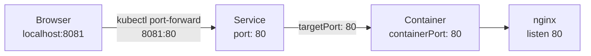

Every number must line up: Service `targetPort` = container port = the port nginx listens on. (`containerPort` is mostly informational, but keep it accurate.)

### 5.6 Health probes

```yaml
readinessProbe: { httpGet: { path: /, port: 80 } }
livenessProbe:  { httpGet: { path: /, port: 80 } }
```

| Probe | Question | If it fails |
|---|---|---|
| **readiness** | "Can this pod receive traffic **right now**?" | The pod is **removed from the Service** (no traffic), but not restarted |
| **liveness** | "Is this pod **stuck or dead**?" | The kubelet **restarts** the container |
| *startup* (not used here) | "Has a slow app finished starting?" | Holds off the other probes until it passes |

Readiness is what makes rolling updates **zero-downtime**: a new pod gets traffic only after it answers successfully.

### 5.7 Resources

```yaml
resources:
  requests: { cpu: 10m, memory: 16Mi }   # guaranteed minimum; the scheduler uses this
  limits:   { memory: 64Mi }             # hard ceiling; above it the pod is OOMKilled
```

- `10m` = 10 millicores = 1% of one CPU core. `16Mi` = 16 mebibytes.
- **Requests** decide *where* a pod fits. **Limits** stop one pod from starving the others.
- There's deliberately **no CPU limit**. CPU is throttled rather than killed, and CPU limits often cause needless slowdowns. Setting a memory limit and no CPU limit is a common production choice.

### 5.8 A rolling update, step by step

When Argo CD changes the image tag from `sha-aaa` to `sha-bbb`:

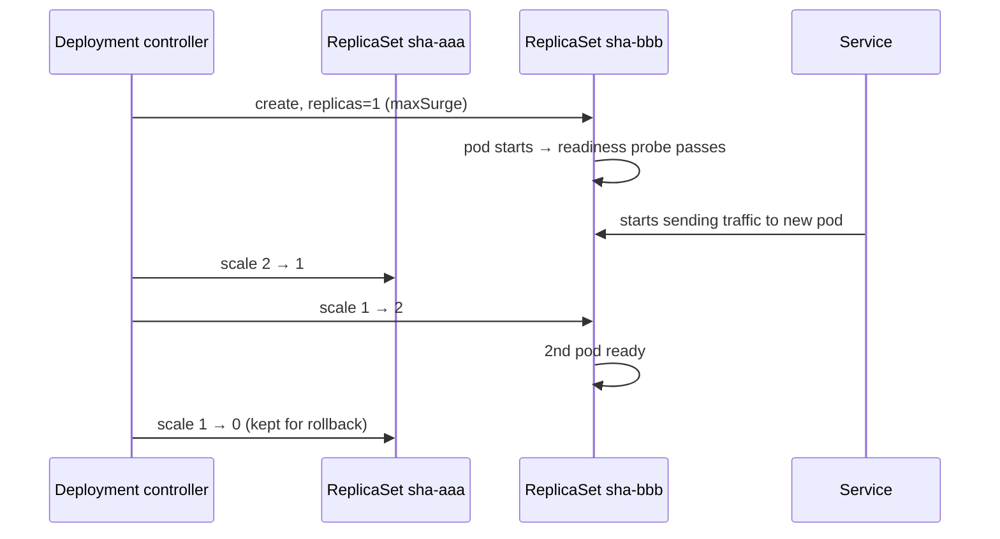

The defaults are `maxSurge: 25%` (rounded up, so 1 extra pod) and `maxUnavailable: 25%` (rounded down, so 0 pods missing). With 2 replicas, the app never has fewer than 2 ready pods during the update.

---

## 6. Namespaces in depth

### 6.1 What a namespace is

A **namespace** is a **virtual partition inside one cluster**: a named folder for Kubernetes objects.

Think of a cluster as an apartment building. Namespaces are the **apartments**. They share the building's plumbing (nodes, network, control plane), but each one has its own rooms, its own name tags on the doors, and its own rules for who can enter.

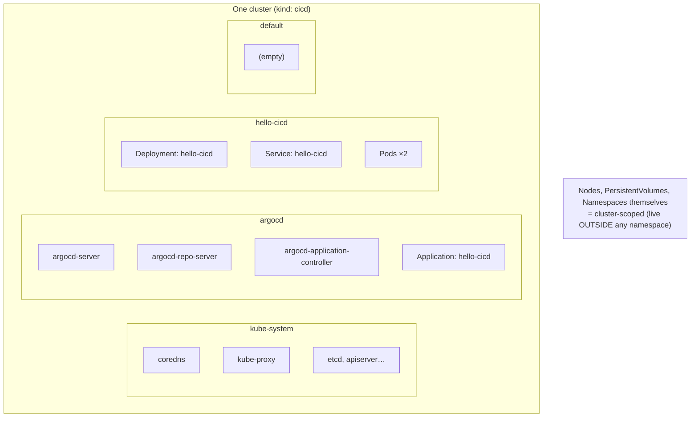

### 6.2 Why namespaces exist

| Purpose | Example |
|---|---|
| **Name scoping** | Names only need to be unique *within* a namespace. `hello-cicd/Service/hello-cicd` and `staging/Service/hello-cicd` can both exist. |
| **Organisation** | Group by app, team or environment: `team-payments`, `staging`, `prod` |
| **Access control (RBAC)** | "Team A can edit `team-a` but only view `team-b`" |
| **Resource limits** | A `ResourceQuota` per namespace: "`dev` may use at most 4 CPUs" |
| **Network isolation** | A `NetworkPolicy` can block traffic between namespaces |
| **Easy cleanup** | `kubectl delete namespace hello-cicd` deletes everything inside it |

A namespace is **not** a security boundary on its own. Pods in different namespaces can still talk to each other over the network unless a NetworkPolicy blocks it. It's a *management* boundary that you can *harden* with RBAC, quotas and network policies.

### 6.3 Namespaced vs cluster-scoped resources

| Namespaced (live *inside* a namespace) | Cluster-scoped (global) |
|---|---|
| Pod, Deployment, ReplicaSet, Service, ConfigMap, Secret, Ingress, Role, **Argo CD Application** | Node, Namespace, PersistentVolume, StorageClass, ClusterRole, CustomResourceDefinition |

Run `kubectl api-resources --namespaced=true` to see the full list.

### 6.4 The namespaces in your cluster

| Namespace | Created by | Contains |
|---|---|---|
| `kube-system` | Kubernetes | Cluster internals (DNS, proxy, control plane). Don't touch it. |
| `default` | Kubernetes | Where things go if you don't name a namespace. Avoid using it for real apps. |
| `kube-public`, `kube-node-lease` | Kubernetes | Public cluster info; node heartbeats |
| `local-path-storage` | kind | Local disk provisioner |
| **`argocd`** | **You**: `kubectl create namespace argocd` | Argo CD itself, **and** your `Application` object |
| **`hello-cicd`** | **Argo CD**, because of `CreateNamespace=true` | Your app's Deployment, ReplicaSet, Pods, Service |

### 6.5 Why this project uses two namespaces

**Separation of the tool from the workload.** Argo CD is infrastructure that deploys things; `hello-cicd` is a thing being deployed. Keeping them apart means:

- you can delete or recreate the app namespace without breaking Argo CD,
- you can later give developers access to `hello-cicd` but not to `argocd`, which holds admin credentials,
- you can later add `hello-cicd-staging` and `hello-cicd-prod` as more namespaces in the same pattern.

### 6.6 How your app ends up in `hello-cicd`

Look at `k8s/deployment.yaml`: **it has no `namespace:` field.** The namespace comes from Argo CD's Application:

```yaml
# argocd/application.yaml
destination:
  server: https://kubernetes.default.svc
  namespace: hello-cicd        # ← "put objects with no namespace here"
syncPolicy:
  syncOptions:
    - CreateNamespace=true     # ← "create it if it doesn't exist"
```

The manifests describe **what** to run, and the Application decides **where** to run it. This is a good habit: the same `k8s/` folder could be deployed to `staging` or `prod` just by changing the destination.

### 6.7 Namespaces and DNS

Every Service gets a DNS name based on its namespace:

```
<service>.<namespace>.svc.cluster.local
hello-cicd.hello-cicd.svc.cluster.local
```

A pod in the *same* namespace can just use `http://hello-cicd`. A pod in a *different* namespace must use at least `http://hello-cicd.hello-cicd`.

### 6.8 Namespace commands

```bash
kubectl get namespaces                          # list them
kubectl get all -n hello-cicd                   # -n = which namespace to look in
kubectl get pods -A                             # -A = all namespaces
kubectl config set-context --current --namespace=hello-cicd   # change your default namespace
```

**A common beginner mistake:** you run `kubectl get pods`, see "No resources found", and panic. You looked in `default`. Add `-n hello-cicd`.

---

## 7. Argo CD: the CD engine

### 7.1 What Argo CD is

Argo CD is a **GitOps controller that runs inside Kubernetes**. Its single job:

> Keep checking: does the cluster match what Git says? If not, make it match.

### 7.2 Custom Resources: how Argo CD extends Kubernetes

Kubernetes is **extensible**. A **CustomResourceDefinition (CRD)** teaches the API server a brand-new object type. Installing Argo CD (`kubectl apply -f install.yaml`) added CRDs such as:

- `Application`: "deploy *this* Git path to *that* cluster or namespace"
- `AppProject`: a group of Applications with permission rules (you use the built-in `default`)
- `ApplicationSet`: a template that generates many Applications

So `argocd/application.yaml` is a Kubernetes object, just like a Deployment. You `kubectl apply` it, and it's stored in etcd. Argo CD's controller **watches** these objects, which is the **operator pattern**: a CRD plus a controller that reconciles it.

### 7.3 Argo CD's components

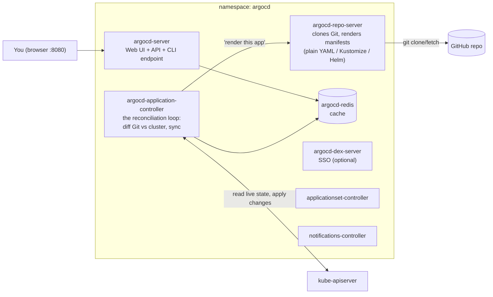

### 7.4 Your Application, field by field

```yaml
apiVersion: argoproj.io/v1alpha1
kind: Application                # the CRD type
metadata:
  name: hello-cicd
  namespace: argocd              # Application objects live where Argo CD is installed
spec:
  project: default               # AppProject: permission boundary
  source:                        # ── WHERE the desired state comes from ──
    repoURL: https://github.com/YOUR_USERNAME/hello-cicd.git
    targetRevision: main         # branch, tag or commit to follow
    path: k8s                    # folder inside the repo
  destination:                   # ── WHERE to apply it ──
    server: https://kubernetes.default.svc   # "this same cluster"
    namespace: hello-cicd
  syncPolicy:
    automated:                   # sync without a human clicking "Sync"
      prune: true                # removed from Git → deleted from cluster
      selfHeal: true             # changed in cluster → reverted to Git
    syncOptions:
      - CreateNamespace=true
```

### 7.5 The two statuses: Sync and Health

Argo CD shows **two separate** statuses. Don't mix them up:

| Status | Question it answers | Values |
|---|---|---|
| **Sync status** | Does the cluster match Git? | `Synced`, `OutOfSync` |
| **Health status** | Is what's running actually working? | `Healthy`, `Progressing`, `Degraded`, `Missing`, `Suspended` |

An app can be `Synced` but `Degraded`. For example, Git says to use image `sha-bad`, and the cluster faithfully runs it, but it crashes. Argo CD did its job, and your image is broken.

### 7.6 The Argo CD reconciliation loop

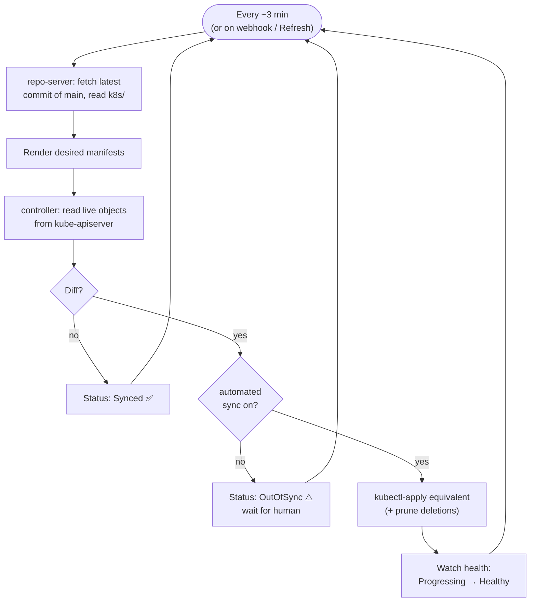

**Why about 3 minutes?** Argo CD *polls* Git, by default every 180 seconds plus some random jitter. In production you add a **GitHub webhook**, so GitHub tells Argo CD about a push immediately. That needs your Argo CD to be reachable from the internet, which your laptop cluster isn't; hence polling here.

### 7.7 `prune` and `selfHeal` in practice

| You do this… | Without the flag | With the flag |
|---|---|---|
| Delete `k8s/service.yaml` from Git | The Service stays in the cluster as an orphan | `prune: true` deletes it |
| `kubectl scale deploy hello-cicd --replicas=5` | Stays at 5, and the cluster *drifts* from Git | `selfHeal: true` puts it back to 2 within seconds |
| `kubectl edit` the image by hand | The hand edit stays | Reverted to whatever Git says |

The lesson: **with GitOps, Git is the only real way to change the cluster.** If you want a change, make it with a commit.

---

## 8. How Kubernetes and Argo CD connect

This is the piece most beginners find confusing, so here's every connection.

### 8.1 Argo CD *is* a Kubernetes app

Argo CD isn't an external service. It's a set of Deployments and Pods running in the `argocd` namespace, like your app runs in `hello-cicd`. Check with `kubectl get pods -n argocd`.

### 8.2 Connection 1: Argo CD → the Kubernetes API (to deploy)

```yaml
destination:
  server: https://kubernetes.default.svc
```

- `kubernetes.default.svc` is the **in-cluster DNS name of the API server**. It's the `kubernetes` Service in the `default` namespace, which exists in every cluster.
- So "deploy to `https://kubernetes.default.svc`" means **"deploy to the cluster I'm running in."**
- **How does it authenticate?** Every pod gets a **ServiceAccount** token mounted automatically. The `argocd-application-controller` pod runs as the ServiceAccount `argocd-application-controller`, and the install manifest gave it a **ClusterRole** (via a ClusterRoleBinding) that allows it to create and update resources. That's **RBAC** (Role-Based Access Control).
- Argo CD can also manage *other* clusters (`argocd cluster add`). Their credentials are stored as Secrets in the `argocd` namespace. One Argo CD controlling many clusters is a common production setup ("hub and spoke").

### 8.3 Connection 2: Argo CD → GitHub (to read desired state)

- The `argocd-repo-server` pod clones `repoURL` over HTTPS.
- Your repo is **public**, so no credentials are needed. A private repo needs a token or SSH key, registered as a repository Secret in Argo CD.
- It's an **outbound** connection from your laptop to github.com, so no firewall or port-forward is needed.

### 8.4 Connection 3: Kubernetes nodes → ghcr.io (to get the image)

- **Argo CD never touches images.** It only writes YAML (the image *name*) to the API server.
- The **kubelet** on the node sees a pod that needs `ghcr.io/…:sha-2327152` and tells **containerd** to pull it.
- Your image is **public**, so no credentials are needed. That's why README Step 2 makes the package public. A private image needs an `imagePullSecret`; otherwise you get the `ImagePullBackOff` error.

### 8.5 Connection 4: you → the app

`kubectl port-forward -n hello-cicd svc/hello-cicd 8081:80` opens a tunnel: **your laptop → API server → the pod**. It's a debugging tool. In production, users come in through an Ingress or a LoadBalancer.

### 8.6 All the connections at once

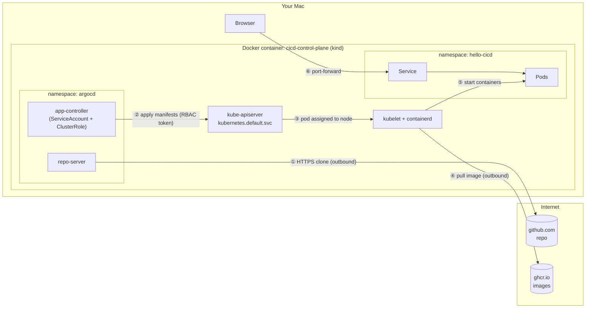

---

## 9. End-to-end: following one change

You change `MESSAGE` in `src/App.jsx` from "Hello, World!" to "Hello, CI/CD!". Here's everything that happens.

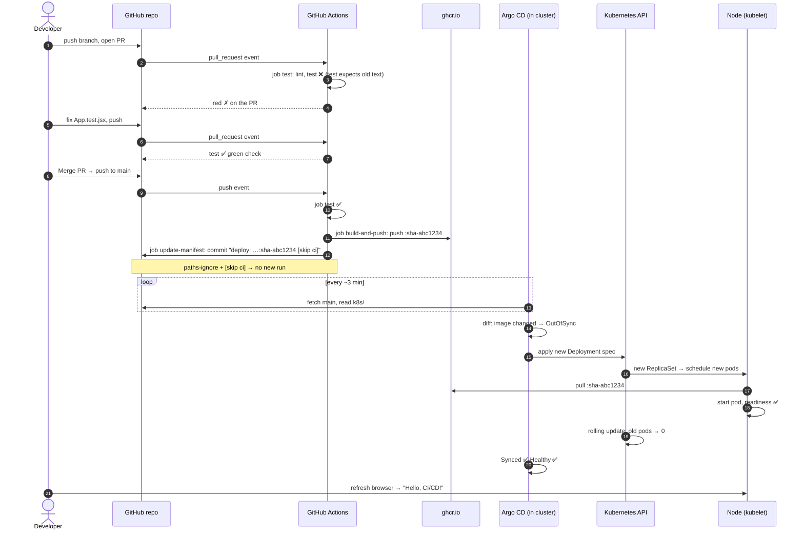

**Where it can stop, and what that tells you:**

| Failed at | Meaning | Where to look |
|---|---|---|
| Step 3 (`test`) | Your code is broken. CI worked. | Actions tab → job log |
| `build-and-push` | Dockerfile problem or registry permissions | Actions log; `packages: write` |
| `update-manifest` 403 | The token can't push | Settings → Actions → Workflow permissions |
| Argo CD `OutOfSync` for a long time | It hasn't polled yet, or there's a sync error | Argo UI → app → Events; click **Refresh** |
| Pods `ImagePullBackOff` | The cluster can't download the image | Is the package public? Is the tag right? `kubectl describe pod` |
| Pods `CrashLoopBackOff` | The image starts and then dies | `kubectl logs` |
| `Synced` but the old page shows | Browser cache, or a stale port-forward | Hard refresh; restart the port-forward |

---

## 10. File-by-file connection map

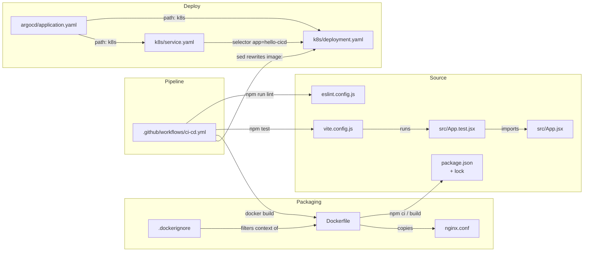

| File | Read by | Purpose | Change it when… |
|---|---|---|---|
| `src/App.jsx` | Vite, the tests | The app | Changing features |
| `src/App.test.jsx` | Vitest (CI `test` job) | The safety net | The behaviour changes on purpose |
| `package.json` / lock | npm (locally, CI, Dockerfile) | Dependencies and scripts | Adding libraries |
| `Dockerfile` | `build-and-push` job | How to package the app | Changing runtime or base image |
| `nginx.conf` | nginx in the container | How files are served | Routing, headers, caching |
| `.github/workflows/ci-cd.yml` | GitHub Actions | The whole CI pipeline | Adding stages (scans, envs) |
| `k8s/deployment.yaml` | Argo CD → K8s | *What* runs: image, replicas, probes | Scaling, resources. **The bot owns `image:`** |
| `k8s/service.yaml` | Argo CD → K8s | Stable network endpoint | Ports |
| `argocd/application.yaml` | **You** (`kubectl apply`, once) | Connects Argo CD to the repo | Changing repo, branch or namespace |

`argocd/application.yaml` is in `paths-ignore` and **isn't** deployed by Argo CD itself. You apply it by hand once. That's a bootstrap step: something has to tell Argo CD to start watching. In production this is solved with the **"App of Apps"** pattern (§13.6).

---

## 11. Building the pipeline from scratch (recipe)

Here's the order you'd build this in for a new project, and why each step comes where it does.

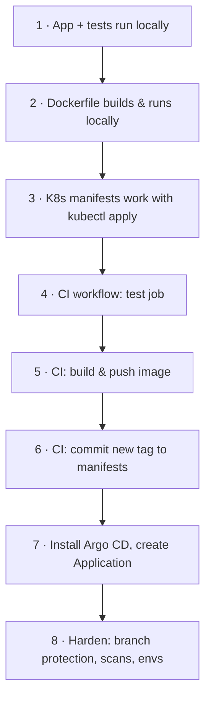

**Rule: get each layer working by hand before you automate it.** If `docker run` doesn't work on your laptop, it won't work in the pipeline either, and the pipeline is a worse place to debug.

### Step 1: The app and its tests
```bash
npm install && npm run lint && npm test && npm run build
```

### Step 2: The container, tested locally
```bash
docker build -t hello-cicd:dev .
docker run --rm -p 8080:80 hello-cicd:dev    # open http://localhost:8080
```

### Step 3: The Kubernetes manifests, tested by hand
```bash
kind create cluster --name cicd
kind load docker-image hello-cicd:dev --name cicd      # copies the local image into kind
kubectl create namespace test
kubectl apply -n test -f k8s/
kubectl set image -n test deploy/hello-cicd web=hello-cicd:dev
kubectl get pods -n test -w
kubectl delete namespace test                           # clean up
```

### Step 4: The CI `test` job
The `on:` triggers plus the `test` job. Push it and check the green tick on a PR.

### Step 5: Build and push
Add the `build-and-push` job with `permissions: packages: write`, the login, and `build-push-action`. Check that the package appears under your GitHub profile, then make it public.

### Step 6: The GitOps commit-back
Add `update-manifest`, with `contents: write`, the `sed` bump, the commit, and `paths-ignore` to avoid loops. Turn on read/write workflow permissions.

### Step 7: Argo CD
```bash
kubectl create namespace argocd
kubectl apply -n argocd --server-side --force-conflicts \
  -f https://raw.githubusercontent.com/argoproj/argo-cd/stable/manifests/install.yaml
kubectl apply -f argocd/application.yaml
```

### Step 8: Hardening
See §13.

---

## 12. Operating it: rollback, self-heal, debugging

### 12.1 Rollback the GitOps way
```bash
git log --oneline -- k8s/              # find the bot's deploy commits
git revert <bad-deploy-commit>         # creates a new commit restoring the old tag
git push                               # Argo CD rolls back
```
You **don't** use `kubectl rollout undo`: selfHeal would undo your undo, because Git still says to use the bad version. **Fix Git, not the cluster.**

### 12.2 Watch self-heal happen
```bash
kubectl scale deploy hello-cicd -n hello-cicd --replicas=5
kubectl get pods -n hello-cicd -w      # watch: 5 → back to 2
```

### 12.3 A debugging toolkit

```bash
# What's there?
kubectl get all -n hello-cicd
kubectl get pods -n hello-cicd -o wide

# Why is it broken? (the "Events" at the bottom are gold)
kubectl describe pod <pod-name> -n hello-cicd
kubectl get events -n hello-cicd --sort-by=.lastTimestamp

# What did the app say?
kubectl logs <pod-name> -n hello-cicd
kubectl logs deploy/hello-cicd -n hello-cicd --previous   # logs of the crashed previous container

# Does the Service find pods?
kubectl get endpoints hello-cicd -n hello-cicd

# Get inside
kubectl exec -it deploy/hello-cicd -n hello-cicd -- sh

# Which image is actually running?
kubectl get deploy hello-cicd -n hello-cicd -o jsonpath='{.spec.template.spec.containers[0].image}'

# Argo CD's view
kubectl get applications -n argocd
kubectl describe application hello-cicd -n argocd
```

### 12.4 Common pod states

| State | Meaning | Usual cause |
|---|---|---|
| `Pending` | Not scheduled yet | Not enough CPU or memory; unbound volume |
| `ContainerCreating` | Pulling the image or setting up | Normal for a few seconds |
| `ImagePullBackOff` / `ErrImagePull` | Can't get the image | Typo in the tag, private image, registry down |
| `CrashLoopBackOff` | It starts, crashes, and restarts with growing delays | App error, bad config, OOMKilled |
| `Running` but `0/1 READY` | The readiness probe is failing | Wrong probe path or port |
| `OOMKilled` | Went over the memory limit | Raise `limits.memory`, or fix the leak |

---

## 13. Production-level best practices

This project is deliberately minimal. Here's what a production setup adds, grouped by area, with **what's in this repo now** compared with **what production does**.

### 13.1 Source control and the change process

| Practice | This repo | Production |
|---|---|---|
| Branch protection on `main` | ❌ | ✅ Require a PR, at least one review, and passing `test` checks; no force-push |
| Required status checks | ❌ | ✅ `test` (plus scans) must pass before merging |
| CODEOWNERS | ❌ | ✅ e.g. the platform team must review `k8s/` and `.github/` |
| Signed commits | ❌ | ✅ Often required |
| Conventional commits / changelog | ❌ | Common; drives automatic semver releases |

### 13.2 CI pipeline hardening

| Practice | Why |
|---|---|
| **Pin actions to a full commit SHA**: `actions/checkout@<40-char-sha> # v7.0.1` | A tag like `@v7` can be moved. A compromised action repo could push malicious code under the same tag (supply-chain attacks have happened). Use Dependabot to update the SHAs. |
| **Least-privilege `permissions:`** with a top-level `permissions: {}` default | Each job gets only what it needs (this repo already sets per-job permissions ✅) |
| **Dependabot / Renovate** | Automatic PRs for npm, Docker base image and action updates |
| **Test pyramid**: unit, integration, e2e (Playwright) | One unit test isn't enough confidence for production |
| **Code coverage and quality gates** | Fail the build below a threshold |
| **Fail fast, run in parallel** | Separate lint, test and build jobs run in parallel for speed |
| **OIDC instead of long-lived secrets** | For cloud registries (AWS/GCP/Azure), the workflow gets short-lived credentials through OpenID Connect, so no stored keys |

### 13.3 Supply-chain and image security

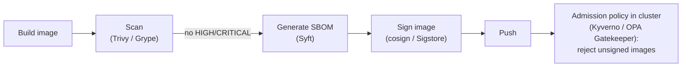

| Practice | Detail |
|---|---|
| **Vulnerability scanning** | Trivy in CI; fail on HIGH or CRITICAL CVEs |
| **SBOM** (Software Bill of Materials) | A list of every package in the image, for auditing and incident response |
| **Image signing and provenance** | `cosign sign`; the cluster checks signatures before running an image |
| **Pin base images by digest** | `FROM nginx:alpine@sha256:…`, so builds are reproducible |
| **Run as non-root** | `nginx:alpine` runs as root by default. Use `nginxinc/nginx-unprivileged` (port 8080) and set a `securityContext` |
| **Minimal images** | Alpine or distroless means fewer packages and fewer CVEs |
| **Private registry plus `imagePullSecrets`** | Most companies don't make images public |

A hardened container spec looks like this:
```yaml
securityContext:
  runAsNonRoot: true
  readOnlyRootFilesystem: true
  allowPrivilegeEscalation: false
  capabilities: { drop: ["ALL"] }
```

### 13.4 Kubernetes workload best practices

| Practice | This repo | Why |
|---|---|---|
| Readiness and liveness probes | ✅ | Zero-downtime deploys; auto-restart |
| Resource requests and memory limit | ✅ | Fair scheduling; protection from noisy neighbours |
| ≥ 2 replicas | ✅ | Survives the loss of one pod |
| **PodDisruptionBudget** | ❌ | Keeps at least N pods up during node maintenance |
| **HorizontalPodAutoscaler** | ❌ | Scales replicas up and down with CPU or traffic |
| **Pod anti-affinity / topology spread** | ❌ | Puts replicas on different nodes and zones |
| **Ingress / Gateway with TLS** (cert-manager) | ❌ | Real HTTPS entry point instead of port-forward |
| **NetworkPolicy** | ❌ | Default-deny; allow only the traffic you need |
| **ResourceQuota and LimitRange per namespace** | ❌ | Stops one team or app from using up the cluster |
| **ConfigMaps and Secrets** for config | n/a | Config separate from the image (12-factor app) |
| **Secrets *not* in plain Git** | n/a | Use Sealed Secrets, External Secrets Operator (with Vault or a cloud secret manager), or SOPS |
| Explicit `strategy:` (maxSurge/maxUnavailable) | defaults | Tune rollout speed and safety |
| Graceful shutdown (`preStop`, `terminationGracePeriodSeconds`) | defaults | Finish in-flight requests before stopping |

### 13.5 Multiple environments and promotion

Production never has a single environment. A typical flow:

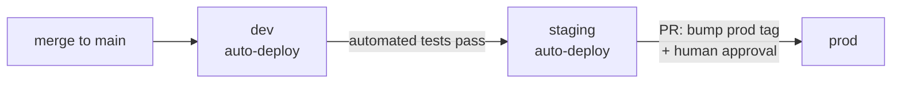

Use **Kustomize** (built into kubectl and Argo CD) or **Helm** to avoid copying YAML for each environment:

```
k8s/
├── base/                    # shared: deployment.yaml, service.yaml, kustomization.yaml
└── overlays/
    ├── dev/                 # replicas: 1, image tag: latest build
    ├── staging/             # replicas: 2
    └── prod/                # replicas: 4, HPA, PDB, bigger resources
```

Each overlay gets its **own namespace** (or its own cluster for prod) and its **own Argo CD Application**. Promotion means **a Git PR that changes the tag in the next environment's overlay**, so every promotion is reviewed, recorded and easy to revert.

**Separate config repo (common in production):**

| | App repo + manifests together (this repo) | App repo + separate config/"GitOps" repo |
|---|---|---|
| Simplicity | ✅ | More moving parts |
| Bot commits mixed into app history | ❌ yes | ✅ clean |
| Different access control (devs vs ops) | Hard | ✅ easy |
| Deploying many apps to many clusters | Messy | ✅ scales |

### 13.6 Argo CD in production

| Practice | Why |
|---|---|
| **Dedicated AppProjects** (not `default`) | Restrict which repos, clusters, namespaces and resource kinds an app may use |
| **SSO (OIDC via Dex) + RBAC**; disable the admin user; delete `argocd-initial-admin-secret` | Real identities and audit trail |
| **App of Apps** or **ApplicationSet** | Argo CD manages its *own* Application manifests from Git, so there's no manual `kubectl apply` bootstrap |
| **Git webhooks** | Deploy in seconds instead of polling every 3 minutes |
| **Argo CD Image Updater** (or Renovate) | Watches the registry and updates tags, replacing the CI commit-back step |
| **Sync waves and hooks** | Order resources: e.g. run a DB migration Job before the Deployment |
| **Notifications** (Slack, Teams) | Alerts on sync failure or degraded health |
| **Manual sync for prod** | `automated` for dev; a human clicks "Sync" (or merges a PR) for prod |
| **High-availability install** (`ha/install.yaml`) | Several replicas of Argo CD's components |
| **Pin the Argo CD version** | Install a specific release instead of `stable`, so upgrades are planned, not accidental |

### 13.7 Progressive delivery

A rolling update moves *all* traffic to the new version as soon as the pods are ready. For production traffic you might prefer:

| Strategy | How | Tool |
|---|---|---|
| **Canary** | Send 5% of traffic to the new version → check metrics → 25% → 100%; roll back automatically on errors | Argo Rollouts, Flagger |
| **Blue/Green** | Run the new version alongside the old one, switch all traffic at once, keep the old one for instant rollback | Argo Rollouts |
| **Feature flags** | Deploy the code switched off and turn it on for some users | LaunchDarkly, Unleash, OpenFeature |

### 13.8 Observability: you can't run what you can't see

| Pillar | Tools |
|---|---|
| **Metrics** | Prometheus + Grafana (kube-prometheus-stack) |
| **Logs** | Loki, Elasticsearch/OpenSearch, or a cloud logging service |
| **Traces** | OpenTelemetry + Tempo/Jaeger |
| **Alerting** | Alertmanager → PagerDuty or Slack |
| **DORA metrics** | Deployment frequency, lead time for changes, change failure rate, time to restore. These measure how well your pipeline serves the business. |

### 13.9 Disaster recovery

- **Git is your config backup.** With GitOps you can rebuild a cluster's apps by installing Argo CD and pointing it at the repo.
- Back up what's **not** in Git: persistent volumes, Secrets, and etcd (Velero, or managed snapshots).
- Practise it: delete a test cluster and rebuild it from Git.

### 13.10 Production readiness checklist

- [ ] `main` is protected; CI is required to pass before merging
- [ ] Actions are pinned by SHA; Dependabot is enabled
- [ ] Images are scanned, signed, run as non-root, and come from a private registry
- [ ] No plaintext secrets in Git
- [ ] Separate dev, staging and prod with PR-based promotion
- [ ] Probes, resources, PDB, HPA and anti-affinity are set
- [ ] Ingress with TLS; NetworkPolicies
- [ ] Argo CD: SSO, RBAC, AppProjects, webhooks, notifications, App of Apps
- [ ] Metrics, logs and alerts are in place; dashboards for each service
- [ ] The rollback procedure has been tested; a DR plan exists

---

## 14. Glossary

| Term | Meaning |
|---|---|
| **Action** | A reusable GitHub Actions step, published as a Git repo (`owner/repo@version`) |
| **Application (Argo CD)** | A custom resource that maps a Git source to a cluster destination |
| **AppProject** | An Argo CD grouping that sets permissions for Applications |
| **ClusterIP** | The default Service type; reachable only inside the cluster |
| **Container** | A running, isolated instance of an image |
| **Control loop / reconciliation** | Observe → diff → act, repeated forever |
| **Controller** | A program that runs a control loop for one kind of object |
| **CRD** | CustomResourceDefinition: adds a new object type to Kubernetes |
| **Declarative** | Describe the desired end state, not the steps |
| **Deployment** | A K8s object that manages ReplicaSets for rolling updates and rollbacks |
| **Desired vs live state** | What Git or the spec says, vs what is actually running |
| **Digest** | An image's content hash (`sha256:…`); immutable |
| **Drift** | When the live state no longer matches the desired state |
| **etcd** | The key-value database that stores all cluster state |
| **GitOps** | Operating infrastructure through Git as the single source of truth, with pull-based reconciliation |
| **GITHUB_TOKEN** | A short-lived token GitHub creates for each workflow run |
| **Image** | A read-only, layered template for containers |
| **Ingress** | HTTP(S) routing from outside the cluster to Services |
| **Job (Actions)** | A group of steps on one runner |
| **kind** | Kubernetes IN Docker: a local cluster made of Docker containers |
| **kubelet** | The node agent that runs a node's pods |
| **Label / selector** | Key/value tags, and the queries that match them; how K8s objects find each other |
| **Manifest** | A YAML file that describes Kubernetes objects |
| **Namespace** | A virtual partition of a cluster, for names, access and quotas |
| **Node** | A machine (VM, physical server, or a Docker container in kind) that runs pods |
| **Operator** | A CRD plus a controller that automates managing an application |
| **Pod** | The smallest deployable unit: one or more containers sharing a network and storage |
| **Probe** | A health check (readiness, liveness, startup) |
| **Prune** | Delete live objects that were removed from Git |
| **RBAC** | Role-Based Access Control: who may do what to which resources |
| **Registry** | Image storage server (ghcr.io, Docker Hub, ECR) |
| **ReplicaSet** | Keeps N identical pods running |
| **Rolling update** | Replacing pods gradually with no downtime |
| **Runner** | The VM or machine that runs a GitHub Actions job |
| **Self-heal** | Argo CD reverting manual changes in the cluster to match Git |
| **Service** | A stable IP and DNS name that load-balances to pods selected by label |
| **ServiceAccount** | An identity for pods, used to authenticate to the K8s API |
| **Sync** | Argo CD applying Git's desired state to the cluster |
| **Tag** | A human-readable, *movable* name for an image version |
| **Workflow** | A GitHub Actions YAML file made of jobs, triggered by events |

---

### Where to go next

1. Do the README "Exercises to try next": rollback, self-heal, branch protection, Trivy, Kustomize environments, Image Updater.
2. Official docs: [Kubernetes concepts](https://kubernetes.io/docs/concepts/) · [Argo CD](https://argo-cd.readthedocs.io/) · [GitHub Actions](https://docs.github.com/actions) · [OpenGitOps](https://opengitops.dev/)
3. Rebuild this project from an empty folder using §11, without looking at the original files.
